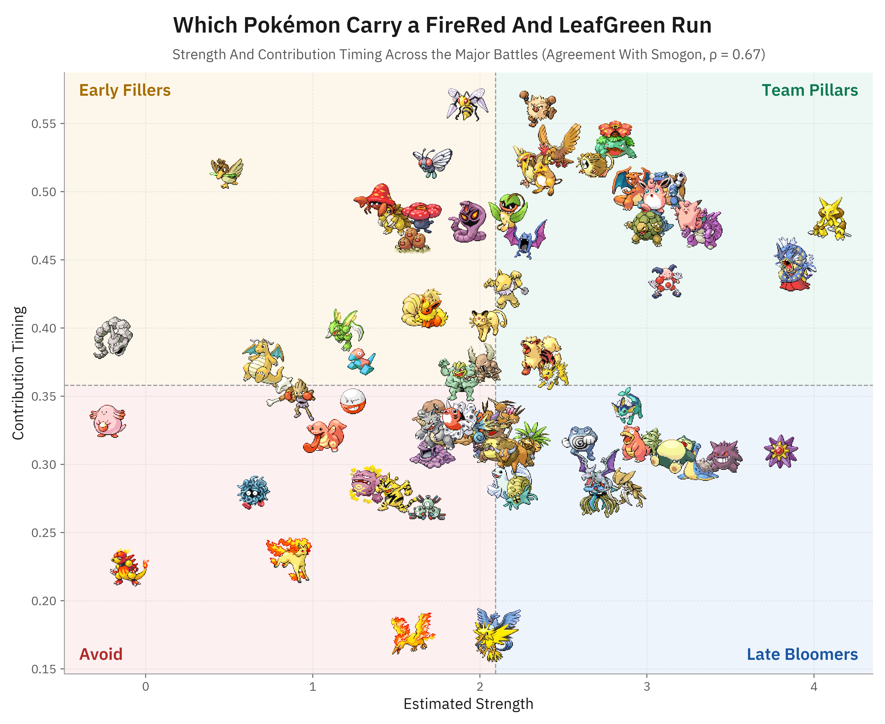

# Pokémon FireRed and LeafGreen In-Game Viability

## Introduction  

This repository is designed for estimating the in-game viability of the Kanto Pokémon in Pokémon FireRed and LeafGreen, namely how efficiently every evolutionary line contributes to completing a standard playthrough. The reference criterion is the [Smogon FireRed and LeafGreen In-Game Tier List](https://www.smogon.com/ingame/guides/adv_frlg_ingametiers), which ranks every line by availability, typing, statistics, movepool, and performance in the major battles of the game.

The exact cartridge data, including base statistics, abilities, learnsets, machine and tutor compatibility, move effects, and the parties of the Gym Leaders, the rival, the Elite Four, and the Champion, are parsed from the [pret/pokefirered](https://github.com/pret/pokefirered) decompilation, while encounters, evolutions, and in-game sprites are retrieved from the [PokéAPI static data](https://github.com/PokeAPI/api-data) and the [PokéAPI sprites](https://github.com/PokeAPI/sprites) repositories. Each line replays the nineteen major battles of the game with the most evolved form and the moves obtainable at that point of the playthrough, resolving every duel with the third-generation damage formula. The resulting battle and ease features are weighted by a non-negative ridge regression on the Smogon tiers, evaluated through leave-one-out cross-validation, and every line is finally placed on a quadrant map of estimated strength against the timing of its contribution over the game.

<p align="center">
  
</p>

## Getting Started

To set up the repository properly, follow these steps:

**1.** **Set Up the Python Environment**  

- To create and activate the virtual environment defined in `pyproject.toml` and `uv.lock`, execute the following command:

  ```bash
  uv sync
  source .venv/bin/activate  # On Windows use: .venv\Scripts\activate 
  ```

**2.** **Run the Viability Estimation**  

- The `src/` folder contains the modular components of the viability estimation:
  - `services/`: Retrieves the pinned PokéAPI documents, the decompilation sources, the in-game sprites, and the IBM Plex Sans font used by the figure.
  - `ingestion/`: Collects the raw documents and parses the cartridge data of the decompilation, cross-checking it against the PokéAPI data species by species.
  - `features/`: Reconstructs the third-generation types and statistics, resolves when every species becomes obtainable, and builds the dataset of the Kanto evolutionary lines.
  - `simulation/`: Computes the third-generation damage and replays the major battles through direct attack, stat-boosting setup, sleep, and paralysis plans.
  - `modeling/`: Weights the battle and ease features against the Smogon tiers and composes the two axes of the quadrant map.
  - `plotting/quadrant_plot.py`: Generates the quadrant map of the evolutionary lines with their in-game sprites.
  - `main.py`: Executes the viability estimation, orchestrating dataset reconstruction, battle simulation, and calibration, and saving the resulting output in the `figures/` directory.

- The `config.toml` file holds every parameter of the estimation, including the commits pinning each remote source, so that the dataset is rebuilt identically at every execution in the `data/` directory.

- Run the following command to execute the full workflow:

  ```bash
  python -m src.main
  ```

## License  

This project is licensed under the **MIT License**, which allows for open-source use, modification, and distribution with minimal restrictions. For more details, refer to the file included in this repository.
